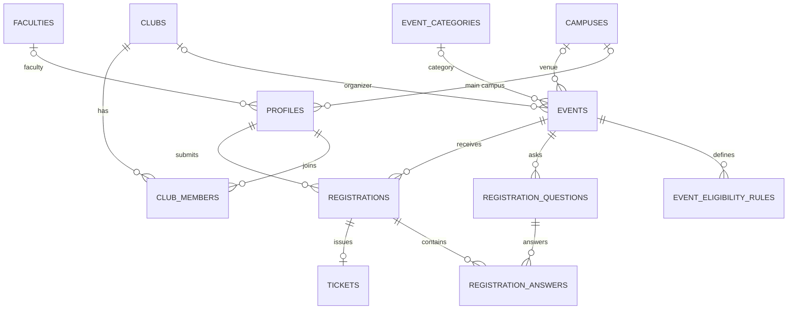

# TUGather

TUGather ช่วยให้นักศึกษาธรรมศาสตร์ค้นหากิจกรรมตามศูนย์และความสนใจ สมัครด้วยข้อมูลนักศึกษา และเปิดตั๋ว QR สำหรับเช็กอิน

[เปิด TUGather บนเว็บ](https://tugather-zeta.vercel.app)

## เริ่มใช้งาน

1. ติดตั้ง dependencies ด้วย `npm ci`
2. คัดลอก `.env.example` เป็น `.env.local` แล้วใส่ Supabase URL และ publishable key ของสภาพแวดล้อมที่ต้องการใช้
3. สำหรับฐานทดสอบใหม่ ให้รัน migrations ใน [supabase/migrations](supabase/migrations) ตามลำดับ แล้วเตรียมข้อมูลทดสอบอย่างน้อย 3 กิจกรรมใน 2 หมวดหมู่ พร้อมบัญชีนักศึกษาและบัญชีสตาฟประจำกิจกรรม
4. เปิดเว็บด้วย `npm run web` หรือเปิด Android emulator แล้วใช้ `npm run android` ดูวิธี deploy ที่ [DEPLOYMENT.md](DEPLOYMENT.md)

## เส้นทางใช้งาน

| หน้า | สิ่งที่ทำได้ |
| --- | --- |
| `/` และ `/login` | ดูจำนวนกิจกรรมที่เปิดรับ เข้าสู่ระบบ สร้างบัญชี หรือไปต่อในฐานะผู้เยี่ยมชม |
| `/home` และ `/explore` | ดูกิจกรรม กรองตามศูนย์หลักหรือทุกศูนย์ ค้นชื่อกิจกรรมและชมรม และกรองหมวดหมู่กับวันที่ใน Explore |
| `/event/[id]` | ดูเวลา สถานที่ ที่นั่ง และเงื่อนไข ตรวจข้อมูลนักศึกษาแล้วส่งใบสมัคร |
| `/tickets` | เปิดตั๋ว QR ดูสถานะการเข้าร่วม หรือยกเลิกเมื่อกิจกรรมยังอนุญาต |
| `/profile` | ดูและแก้ไขข้อมูลนักศึกษา เพิ่มหรือเปลี่ยนรูปโปรไฟล์ สตาฟที่มีสิทธิ์เข้าหน้าเช็กอินได้จากหน้านี้ |
| `/check-in` | เลือกกิจกรรมที่มีสิทธิ์และสแกน QR ของผู้เข้าร่วม |

## สถาปัตยกรรมและสิทธิ์

Expo Router ใช้หน้าจอร่วมกันระหว่างเว็บและ Android เว็บ build เป็น SPA บน Vercel ส่วน Supabase ให้บริการ Auth, PostgreSQL, Storage สำหรับรูปโปรไฟล์ และ Realtime สำหรับอัปเดตตั๋ว โค้ดฝั่งผู้ใช้ใช้ publishable key ฐานข้อมูลตรวจสิทธิ์ด้วย Row Level Security (RLS) และตรวจเงื่อนไขการสมัคร ยกเลิก และเช็กอินในฟังก์ชัน RPC

| ผู้ใช้ | สิทธิ์ในขั้นตอนหลัก |
| --- | --- |
| ผู้เยี่ยมชม | อ่านข้อมูลกิจกรรมที่เผยแพร่และข้อมูลอ้างอิงที่เปิดให้สาธารณะ |
| นักศึกษาที่เข้าสู่ระบบ | อ่านและแก้โปรไฟล์ของตน อ่านและเปลี่ยนรูปของตนใน bucket ส่วนตัว อ่านใบสมัครและตั๋วของตน และเรียก RPC สำหรับสมัครหรือยกเลิก |
| ผู้จัดหรือสตาฟที่ได้รับสิทธิ์ | ดูกิจกรรมที่ตนมีสิทธิ์เช็กอินและเรียก RPC เช็กอินสำหรับกิจกรรมนั้น |



## ตรวจงาน DX212

| กรณีทดสอบ | สิ่งที่ควรเห็น |
| --- | --- |
| เปิดทั้ง 8 routes และรีเฟรช URL โดยตรง | เข้าถึงหน้าที่ถูกต้อง รวมถึงหน้าเช็กอินและหน้ารายละเอียดกิจกรรม |
| หน่วง API, คืนรายการว่าง, คืน HTTP 500 และคืนข้อมูลปกติในฐานแยกหรือ mock | Loading, Empty, Error และ Success แยกกันชัดเจน ลองใหม่ได้เมื่อการโหลดล้มเหลว |
| เข้าด้วยบัญชีที่มีศูนย์หลัก แล้วเปลี่ยนตัวกรอง | Home และ Explore เริ่มจากศูนย์หลัก ค้นและกรองร่วมกันได้ และสลับเป็นทุกศูนย์ได้ |
| สมัครในฐานทดสอบแล้วลองส่งซ้ำ | ได้ตั๋วหนึ่งใบ จำนวนที่นั่งลดลงครั้งเดียว |
| เปิดตั๋วแล้วเช็กอินด้วยบัญชีสตาฟ | QR ที่ถูกต้องเช็กอินได้ ตั๋วแสดงสถานะอัปเดต สแกนซ้ำหรือใช้บัญชีที่ไม่มีสิทธิ์แล้วถูกปฏิเสธ |
| รันบน Android และเว็บ | เก็บภาพหรือวิดีโอของขั้นตอนค้นหา สมัคร เปิด QR และเช็กอินด้วยข้อมูลทดสอบ |

`scripts/test-registration.sql` และ `scripts/test-cancellation.sql` เป็นกรณีทดสอบ SQL สำหรับฐานทดสอบที่รัน migrations แล้ว

```sh
npm run lint
npx tsc --noEmit
npx expo export --platform web
```
